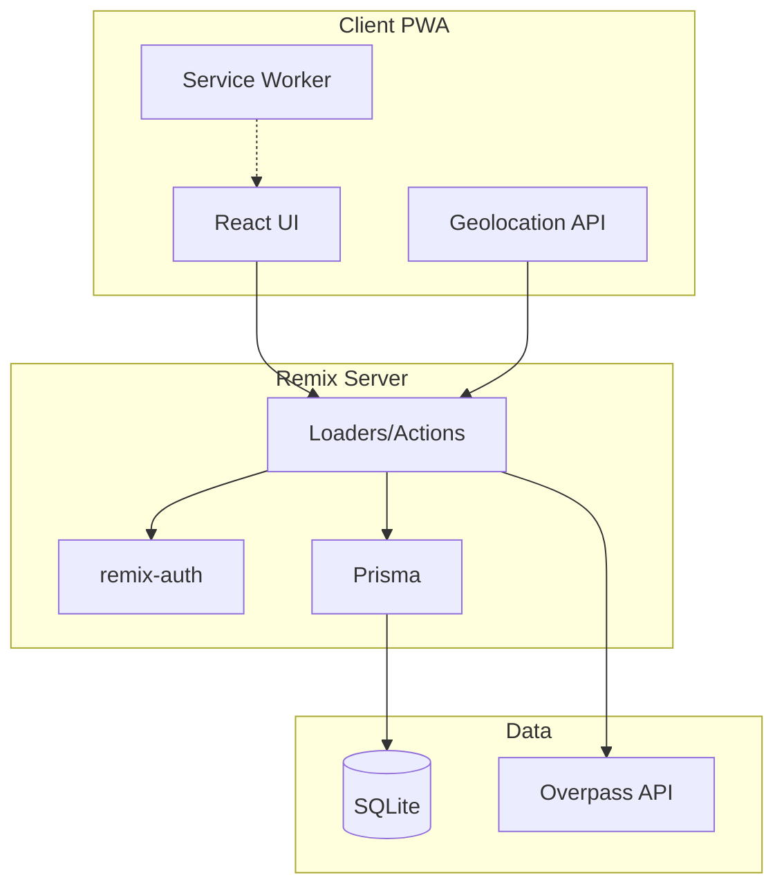

# Car Maintenance Tracking Site - Implementation Plan

## Tech Stack


| Layer         | Choice                                             |
| ------------- | -------------------------------------------------- |
| Framework     | Remix 2.x (uses Vite by default)                   |
| PWA           | `@vite-pwa/remix`                                  |
| Database      | SQLite + Prisma                                    |
| Auth          | `remix-auth` with session storage (email/password) |
| Nearby places | Overpass API (OpenStreetMap) - free, no API key    |


---

## Architecture Overview




---

## Data Model (Prisma Schema)

**Core entities:**

- **User** - `id`, `email`, `passwordHash`, `name`, `createdAt`
- **Car** - `id`, `make`, `model`, `year`, `currentMileage`, `purchaseCost`, `vendor`, `description`, `createdAt`
- **CarMember** (junction) - `carId`, `userId`, `role` (owner | driver)
- **MaintenanceRecord** - `id`, `carId`, `type` (oil_change | tire_rotation | brake_service | etc.), `date`, `mileage`, `cost`, `vendor`, `description`, `createdAt`
- **MaintenanceType** (reference) - `id`, `name`, `defaultIntervalMiles`, `defaultIntervalMonths` for alert logic

**Relationships:**

- User ↔ Car: many-to-many via CarMember
- Car → MaintenanceRecord: one-to-many

---

## Project Structure

```
car-work-tracker/
├── app/
│   ├── components/          # Shared UI components
│   ├── models/               # Prisma + business logic
│   ├── routes/
│   │   ├── _index.tsx        # Dashboard
│   │   ├── login.tsx
│   │   ├── cars/
│   │   │   ├── _index.tsx    # Car list
│   │   │   ├── $carId.tsx    # Car detail + maintenance
│   │   │   └── new.tsx
│   │   ├── maintenance/
│   │   └── api/
│   │       └── nearby-services.ts  # Overpass proxy
│   ├── session.server.ts
│   ├── auth.server.ts
│   └── root.tsx
├── prisma/
│   └── schema.prisma
├── vite.config.ts           # Remix + PWA plugin
└── package.json
```

---

## Implementation Phases

### Phase 1: Project Setup

- Run `npx create-remix@latest` with Vite, TypeScript, SQLite
- Add `@vite-pwa/remix`, configure `RemixVitePWAPlugin` and `RemixPWAPreset` in `vite.config.ts`
- Add Prisma: `prisma init`, schema, `prisma db push`
- Add `remix-auth`, `bcryptjs` for password hashing

### Phase 2: Authentication

- Cookie session storage (`createCookieSessionStorage`)
- `remix-auth` with `FormStrategy` (email/password)
- Auth routes: `/login`, `/logout`, `/signup`
- `getSession` in root loader, redirect unauthenticated users
- Seed an initial user for development

### Phase 3: Cars & Owners/Drivers

- Car CRUD routes with auth checks (user sees only cars they own/drive)
- CarMember management: add/remove owners and drivers per car
- Car form: make, model, year, mileage, cost, vendor, description
- Car list and detail views

### Phase 4: Maintenance History

- MaintenanceRecord CRUD
- Maintenance types: oil change, tire rotation, brake service, filter replacement, etc.
- Maintenance list per car with add/edit/delete
- Display: date, mileage, cost, vendor, description

### Phase 5: Location-Aware Alerts

- **Overpass API integration**: Server route (e.g. `/api/nearby-services?lat=&lon=&radius=5000`) that queries Overpass for `shop=car_repair` and `amenity=car_repair` within radius (meters)
- **Due logic**: Compare last maintenance date/mileage per type vs. `defaultIntervalMiles` and `defaultIntervalMonths`
- **Client**: Request `navigator.geolocation.getCurrentPosition()` (with user consent), call `/api/nearby-services`, merge with "maintenance due" data
- **Alert UI**: Banner or modal when (a) maintenance is due for any car AND (b) user is within ~2 miles of a service station
- PWA manifest: request `geolocation` permission in manifest or prompt on first alert check

### Phase 6: PWA Polish

- Web app manifest: name, icons, theme_color, display: standalone
- Offline: cache static assets and key API responses via Workbox
- Install prompt for "Add to Home Screen"

---

## Key Technical Details

**Overpass API query** (car repair shops near user):

```
[out:json][timeout:10];
(
  node["shop"="car_repair"](around:RADIUS,LAT,LON);
  node["amenity"="car_repair"](around:RADIUS,LAT,LON);
);
out body;
```

- Use public instance: `https://overpass-api.de/api/interpreter`
- Radius: 3000–5000 meters for "nearby"
- Parse JSON response for `lat`, `lon`, `tags.name`

**Maintenance due logic** (pseudocode):

```
for each car user has access to:
  for each maintenance type (e.g. oil_change):
    lastRecord = most recent MaintenanceRecord of that type
    if lastRecord.mileage + intervalMiles < car.currentMileage
       OR lastRecord.date + intervalMonths < today:
      add to "due" list
```

**Auth guard pattern** (in loaders):

```ts
const session = await getSession(request);
if (!session.get("userId")) throw redirect("/login");
const cars = await prisma.car.findMany({
  where: { members: { some: { userId: session.get("userId") } } }
});
```

---

## Dependencies to Add

```json
{
  "dependencies": {
    "remix-auth": "^4.x",
    "remix-auth-form": "^2.x",
    "bcryptjs": "^2.x",
    "@prisma/client": "^5.x"
  },
  "devDependencies": {
    "@vite-pwa/remix": "^0.2.x",
    "prisma": "^5.x"
  }
}
```

---

## Out of Scope (Future Enhancements)

- Push notifications for maintenance reminders (requires service worker + notification permission)
- Photo attachments for maintenance records
- Export maintenance history (CSV/PDF)
- Dark mode / theme toggle

