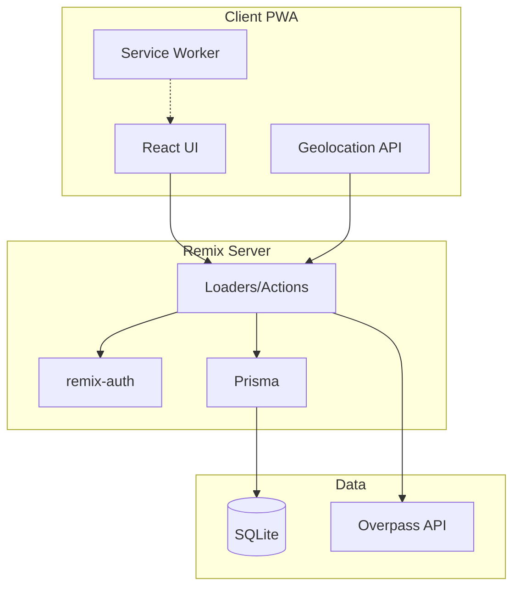

# Architecture Overview

## Tech Stack

| Layer         | Choice                                             |
| ------------- | -------------------------------------------------- |
| Framework     | Remix 2.x (uses Vite by default)                   |
| PWA           | `@vite-pwa/remix`                                  |
| Database      | SQLite + Prisma                                    |
| Auth          | `remix-auth` with session storage (email/password) |
| Nearby places | Overpass API (OpenStreetMap) - free, no API key    |

## High Level Architecture



## Project Structure

```
car-work-tracker/
├── app/
│   ├── components/          # Shared UI components
│   ├── models/               # Prisma + business logic
│   ├── routes/
│   │   ├── _index.tsx        # Dashboard
│   │   ├── login.tsx
│   │   ├── cars/
│   │   │   ├── _index.tsx    # Car list
│   │   │   ├── $carId.tsx    # Car detail + maintenance
│   │   │   └── new.tsx
│   │   ├── maintenance/
│   │   └── api/
│   │       └── nearby-services.ts  # Overpass proxy
│   ├── session.server.ts
│   ├── auth.server.ts
│   └── root.tsx
├── prisma/
│   └── schema.prisma
├── vite.config.ts           # Remix + PWA plugin
└── package.json
```
