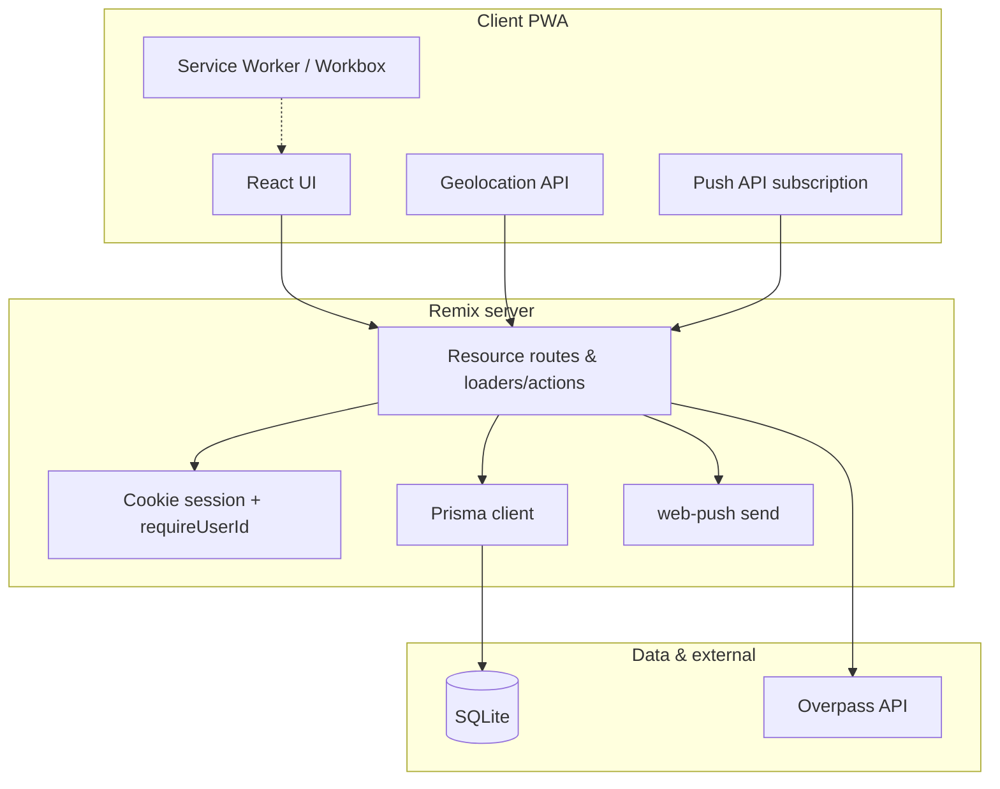

# Car Work Tracker — Product & Technical Epic

## What the app is for

**Car Work Tracker** helps people who own or drive cars (often multiple cars or shared family vehicles) remember what was done, when it is due again, and how much it costs over time. It is optimized for quick logging in the browser, optional install as a PWA, and light-touch collaboration via **owner/driver** roles on each car.

**Primary jobs:**

- Log maintenance (type, date, mileage, cost, vendor, notes, optional receipt URL) and keep **current mileage** in sync when a service record exceeds the car’s stored odometer.
- See **what is due or approaching** across the fleet, with per-type intervals from global defaults plus **per-car overrides** when the factory schedule does not match your use case.
- Track **fuel fills** to derive MPG and fuel spend; track **insurance/registration/etc.** documents with optional expiry and dashboard visibility.
- When something is due, optionally surface **nearby repair shops** using the device location and OpenStreetMap data (no map API key).
- Optional **web push** (VAPID) for reminders when the app is configured with push keys.

### Information architecture & product flow

**Mental model:** the **dashboard** (`/`) is fleet-wide—what needs attention across all cars. The **car detail** page (`/cars/:carId`) is the hub for work on one vehicle (log service, mileage, fuel, documents, schedule, intervals, members, printable maintenance).

#### Global navigation (shell)

Implemented in `app/root.tsx`. Labels below match the UI.

| Nav label   | Primary routes                         | User intent |
| ----------- | -------------------------------------- | ----------- |
| Dashboard   | `/`                                    | Fleet cards, due/approaching, health hints, document expiry summary, install prompt, nearby-services alert when relevant |
| My Cars     | `/cars`, `/cars/new`, `/cars/:id`     | Vehicle list and **per-car workspace** |
| Compare     | `/compare`                             | Side-by-side fleet comparison (cost per mile, MPG, health, due items) |
| History     | `/maintenance`                         | Cross-car maintenance timeline (route file: `maintenance._index.tsx`) |
| Search      | `/search`                              | Unified lookup across cars, records, documents, fuel (query ≥ 2 chars) |
| Reports     | `/reports`                             | Aggregated analytics—YoY cost, cost by car/type, rollups |
| Settings    | `/settings`                            | **Global** maintenance type catalog and push subscription UI |
| Profile     | `/profile`                             | Account name/password; logout via form action |

#### Terminology (UI ↔ routes)

- **History** — nav label for `/maintenance` (fleet maintenance list), not a separate feature name in code.
- **Schedule** — car hub button for `/cars/:carId/forecast` (per-type interval progress / service schedule view).
- **Service Intervals** — car hub entry for `/cars/:carId/overrides` (`CarMaintenanceOverride` editor).
- **Reports** vs **Compare** — *Reports* is time/aggregate rollups; *Compare* is multi-car side-by-side for the same session.

#### Roles and permissions

Product rules for `CarMember.role` (`owner` or `driver`). **Owners** can manage destructive and structural actions for that car (e.g. edit/delete car, manage members, invite with role). **Drivers** participate in logging and viewing; sensitive car-level mutations are owner-gated in routes. When extending features, keep permission checks aligned with this split.

#### Global vs per-car configuration

- **Global defaults:** `MaintenanceType` intervals and labels are edited in **Settings**; they apply to all cars unless overridden.
- **Per-car exceptions:** **Service Intervals** on a car set `CarMaintenanceOverride` for that car + type (factory schedule differs, high-mileage use case, etc.).
- **Push** is user-scoped (`PushSubscription`), configured in Settings, not per car.

#### Nav badge vs dashboard

The header **due badge** counts actionable items for quick scanning: maintenance intervals that read as due (simplified per-type check across the user’s non-archived cars) plus **document expiry** rows that are expired or due within about seven days. The **dashboard** uses richer batch helpers (due, approaching, health scores). The two are related but not identical—when changing either, preserve intentional UX (badge = “something to look at”; dashboard = full fleet story).

#### UX guardrails

- Mobile-friendly shell (collapsible nav); primary tasks reachable from dashboard or car hub without deep nesting.
- PWA install path remains visible where supported (`InstallPrompt`).
- Exports remain discoverable from report flows and per-car export routes (see route map).

---

## Tech stack

| Layer         | Choice                                                                      |
| ------------- | --------------------------------------------------------------------------- |
| Framework     | Remix 2.x on Vite (`@remix-run/dev`, `@remix-run/node`, `@remix-run/react`) |
| PWA           | `vite-plugin-pwa` (manifest, Workbox, offline fallback, runtime caches)     |
| Database      | SQLite + Prisma 5 (`DATABASE_URL`)                                          |
| Auth          | `remix-auth` + `remix-auth-form`, cookie sessions, `bcryptjs`               |
| Push          | `web-push` + stored `PushSubscription` rows; `VAPID_*` env vars             |
| Nearby places | Overpass API (`overpass-api.de`) — nodes and ways, `out center`             |
| Tests         | Vitest (jsdom), Testing Library; `npm run test:ci` in CI                    |

---

## Testing strategy (required bar for changes)

This app handles **money** (costs, exports), **safety-adjacent scheduling** (what is due by mileage or time), and **access control** (who may see or edit which car). Regressions are expensive for users, so **good automated tests are part of the epic**, not an afterthought.

### Unit tests

**Use for:** pure logic and small modules with clear inputs and outputs—no real network and ideally no real database.

- **Utils and formatting** — dates, mileage/currency labels, CSV escaping, validators (`app/utils/`, `app/models/*.server.ts` where logic is extractable).
- **Domain rules** — maintenance due / approaching / health calculations, interval overrides, batch helpers: assert edge cases (no history, only miles or only months, leap years, tied mileage).
- **Adapters** — web-push payload shaping, session cookie parsing, anything that can run against mocks or fixed strings.

**Expectation:** new pure functions or nontrivial branches ship with focused unit tests alongside the code.

### Integration tests

**Use for:** behavior that spans **Remix boundaries** (loaders, actions, resource routes), **session/auth**, or **Prisma + SQLite** with realistic data shapes.

- **Loaders and actions** — `Request`/`Response` flows: redirects when unauthenticated, 404 when car is not a member, correct JSON or CSV headers for export routes.
- **Server models** — `*.server.ts` functions against a **test database** (or migrate/push schema in test setup) when the interaction of multiple tables matters more than a single formula.
- **API routes** — query validation, error status codes, response shape (e.g. nearby-services with mocked `fetch` to Overpass).

**Expectation:** new routes or changed auth/data rules for sensitive paths include at least one integration-style test that would have caught the bug class you are fixing. Prefer testing **public contracts** (HTTP status, body shape, headers) over implementation details.

### Tooling and CI

- Tests live under **`tests/**/*.test.{ts,tsx}`** with shared setup in **`tests/setup.ts`**.
- **`vitest.config.ts`** defines coverage thresholds (statements/functions/lines at 80%, branches at 70%); keep new code from lowering coverage without discussion.
- **`npm run ci`** runs typecheck, build, and **`test:ci`** (non-watch); merges should stay green.

### Component tests (where they add value)

Use **Testing Library** for interactive UI when logic is non-trivial (forms with validation, conditional banners). Not every presentational component needs a test; prioritize user-visible failure modes.

### Gaps and growth

- **`test:e2e`** (smoke script) can supplement Vitest for deploy confidence; the epic treats **Vitest unit + integration** as the default requirement, with e2e as optional depth for critical journeys (login → add maintenance → export).

---

## Architecture overview

**Security baseline:** global loaders set `Content-Security-Policy` (self + Overpass for `connect-src`; images allow `https:` for hosted receipts/photos). `X-Frame-Options`, `X-Content-Type-Options`, and `Referrer-Policy` are set in `root.tsx`.

---

## Data model (Prisma)

**Identity & access**

- **User** — `id`, `email`, `passwordHash`, `name`, `createdAt`; relations to `CarMember`, `PushSubscription`.
- **CarMember** — `carId`, `userId`, `role` (string: `owner` or `driver`); unique `(carId, userId)`. See [Roles and permissions](#roles-and-permissions) for product behavior.

**Vehicle**

- **Car** — `make`, `model`, `year`, `currentMileage`, optional `purchaseCost`, `vendor`, `description`, `imageUrl`, `notes`, `vin`, `color`, `isArchived`, timestamps.
- **OdometerLog** — point-in-time mileage readings with optional note.
- **CarMaintenanceOverride** — per car + `typeName`, optional `intervalMiles` / `intervalMonths` overriding `MaintenanceType` defaults.

**Maintenance**

- **MaintenanceType** — catalog of service keys (`name` unique), optional `defaultIntervalMiles`, `defaultIntervalMonths` (seeded defaults; users can CRUD in Settings).
- **MaintenanceRecord** — `carId`, `type` (string key), `date`, `mileage`, optional `cost`, `vendor`, `description`, `receiptUrl`.

**Fuel & paperwork**

- **FuelLog** — `date`, `mileage`, `gallons`, optional `pricePerGallon`, `totalCost`, `fullTank`, `notes`.
- **CarDocument** — `type` (insurance, registration, inspection, warranty, other), `title`, optional `expiryDate`, `fileUrl`, `notes`.

**Push**

- **PushSubscription** — `userId`, `endpoint` (unique), `p256dh`, `auth`.

**Relationships (summary):** User ↔ Car many-to-many via `CarMember`. Car owns logs/records/overrides/documents/fuel. User owns push endpoints.

---

## Route map (implemented)

Remix file conventions under `app/routes/`. Grouped for scanability; together this is the authoritative inventory.

### Shell, auth, account

| Route file(s) | Behavior |
| ------------- | -------- |
| `_index.tsx` | Dashboard: fleet cards, due/approaching, health hints, document expiry summary, `NearbyServicesAlert`, `InstallPrompt` |
| `login.tsx`, `signup.tsx`, `logout.ts` | Auth flows |
| `profile.tsx` | Account |
| `offline.tsx` | PWA navigate fallback |

### Global tools (cross-car)

| Route file(s) | Behavior |
| ------------- | -------- |
| `maintenance._index.tsx` | **History** in nav—cross-car maintenance list |
| `search.tsx` | Search cars, maintenance, documents, fuel (query ≥ 2 chars) |
| `reports._index.tsx` | **Reports**—YoY cost, cost by car/type, rollups |
| `compare.tsx` | **Compare**—side-by-side fleet comparison (cost per mile, MPG, health, due items) |
| `settings.tsx` | Global maintenance type catalog, `PushManager` |

### Cars and per-car workspace

| Route file(s) | Behavior |
| ------------- | -------- |
| `cars._index.tsx`, `cars.new.tsx` | List and add cars |
| `cars.$carId.tsx` | Car hub: maintenance list, CTAs to schedule, fuel, documents, etc. |
| `cars.$carId.edit.tsx`, `cars.$carId.delete.tsx` | Edit / delete car (owner-gated where applicable) |
| `cars.$carId.members.tsx` | Shared access and roles |
| `cars.$carId.odometer.tsx` | Odometer readings |
| `cars.$carId.fuel.tsx` | Fuel log |
| `cars.$carId.forecast.tsx` | **Schedule** in UI—per-type interval / service schedule view |
| `cars.$carId.overrides.tsx` | **Service Intervals**—per-car overrides |
| `cars.$carId.documents.tsx` | Documents with optional expiry |
| `cars.$carId.print.tsx` | Print-friendly maintenance summary for one car (browser print) |
| `cars.$carId.maintenance.new.tsx`, `cars.$carId.maintenance.$recordId.edit.tsx`, `cars.$carId.maintenance.$recordId.delete.tsx` | Per-record CRUD |

### API and exports

| Route file(s) | Behavior |
| ------------- | -------- |
| `api.nearby-services.ts` | Overpass proxy + haversine sort |
| `api.push.subscribe.ts`, `api.push.unsubscribe.ts`, `api.push.send-test.ts` | Web push endpoints |
| `cars.export.ts`, `maintenance.export.ts`, `maintenance.export-json.ts`, `cars.$carId.maintenance.export.ts`, `cars.$carId.fuel.export.ts` | CSV/JSON downloads |

Shared UI lives under `app/components/` (e.g. `CarCard`, `MaintenanceList`, `NearbyServicesAlert`, `AlertBanner`, `OfflineIndicator`, `InstallPrompt`, `PushManager`). Domain logic is in `app/models/*.server.ts` and `app/utils/` (formatting, CSV, dates, validators).

---

## Maintenance due logic (conceptual)

1. Load all `MaintenanceType` rows and, for each car, all `MaintenanceRecord` rows (ordered by date).
2. For each type that has at least one interval (miles and/or months), resolve effective intervals via **`CarMaintenanceOverride`** when present.
3. Find the **latest** record per `type` for that car; if none, that type is “no history” (used in schedule UI, not necessarily “due”).
4. **Due** when mileage delta ≥ interval miles (if set) **or** months since last service ≥ interval months (if set). Batched variants power the **dashboard**, **Compare**, and related surfaces (`getBatchMaintenanceDue`, approaching bands, health scores). The **nav due badge** uses a related but simpler count for the whole session—see [Nav badge vs dashboard](#nav-badge-vs-dashboard).

Server actions that create/update maintenance records **bump `Car.currentMileage`** when the service mileage is higher than the stored value.

---

## Location-aware alerts

- Client obtains coordinates with `navigator.geolocation` (user consent).
- App calls **`/api/nearby-services`** with `lat`, `lon`, optional `radius` (meters, default ~5 km).
- Server POSTs an Overpass QL query: `shop=car_repair` and `amenity=car_repair` on **nodes and ways**, `out center` so ways resolve to a point.
- Results include computed distance; UI can combine with “maintenance due” state (`NearbyServicesAlert`).
- Workbox caches Overpass responses (`NetworkFirst`) for resilience; CSP allows `connect-src` to `https://overpass-api.de`.

---

## PWA & offline

- **Manifest** (via Vite PWA): name “Car Work Tracker”, standalone display, theme/background colors, icons under `/icons/`.
- **Offline:** `navigateFallback: "/offline"` with denylist for `/api/*`; precache of static assets; runtime caches for API and images.
- **Install:** `InstallPrompt` component for add-to-home-screen style nudges where supported.

---

## Quality & operations

- **Scripts:** `typecheck`, `build`, `test` / `test:ci` / `test:coverage`, `prisma:*`, `gen:vapid`, `check:env`, `check:pwa-assets`, `check:no-dev-db`, aggregated `ci`.
- **Tests:** see [Testing strategy](#testing-strategy-required-bar-for-changes); existing suites under `tests/` include session/auth helpers, car and maintenance server behavior, CSV/export routes, dates, formatters, and web-push utilities.

---

## Dependencies (representative)

Pinned versions belong in `package.json`; at a glance the app depends on Remix 2.15.x, Prisma 5.22.x, React 18, `remix-auth` 3.x, `remix-auth-form` 1.x, `bcryptjs`, `web-push`, and dev tooling including `vite-plugin-pwa`, Vitest, and Testing Library.

---

## Roadmap / out of scope (candidates)

These are **not** required for the core epic but are natural extensions:

- **Branded or PDF-packaged reports** beyond today’s CSV/JSON exports and the per-car **browser print** view (`cars.$carId.print.tsx`—maintenance-focused, not a full design system).
- **First-class file uploads** for receipts/documents (today: URL fields; hosting is out of band).
- **Dark mode toggle** — layout may respect `prefers-color-scheme` in places; a user-controlled theme switch is optional polish.
- **Shop booking or CRM integrations** — discovery only today.
- **Multi-organization / fleet admin** — current model is household-scale sharing via car membership.

---

## Historical note

Early planning treated phases 1–6 as a linear build (scaffold → auth → cars → maintenance → geo → PWA). The codebase has **grown past that baseline** with fuel, documents, overrides, analytics, compare, search, exports, web push, and richer Overpass queries. Treat this document as the **source of truth for product intent and architecture**; individual tickets can still break work into smaller deliverables.

---

## Maintaining this document

When updating this epic (after new routes, schema changes, or roadmap shifts), follow **`docs/skills/car-work-epic.md`** so the doc stays aligned with code and the testing bar. (Cursor loads the same instructions from `.cursor/skills/car-work-epic/SKILL.md`.) Optional traceability lives in `docs/requirements.md` when you use requirement IDs or acceptance notes.
