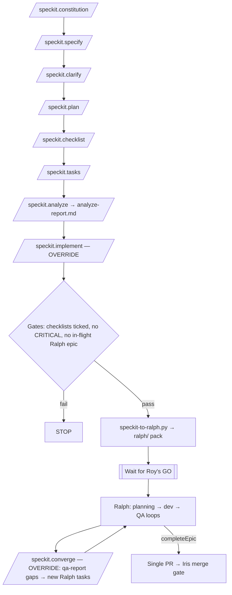

# Spec Kit → Ralph workflow (car-work-tracker)

Spec Kit owns authoring (constitution, specify, clarify, plan, checklist, tasks, analyze).
**Ralph is the only execution path.** The `ralph-handoff` preset replaces `/speckit.implement`
and `/speckit.converge` so neither writes product code. Merge gate is **Iris**.
Nothing merges without Roy's explicit go.



## Sequence

1. Constitution, specify, clarify, plan, checklist, tasks, analyze: stock Spec Kit.
   Save analyze output to `FEATURE_DIR/analyze-report.md`.
2. `/speckit.implement` (override):
   - Checks gates (also enforced in the converter).
   - Runs `python3 .specify/scripts/speckit-to-ralph.py FEATURE_DIR`.
   - Stops at **Start Ralph now?**
3. After Roy says go, Ralph runs as usual. Only QA sets `passes: true`.
4. `/speckit.converge` (override) adds `ralph/qa-report.md` GAP/FAIL lines as new tasks
   in `ralph/task_status.json` (deduped). It never edits `tasks.md` and never sets `passes`.
5. When the epic is complete (`completeEpic: true`): one PR → **Iris** merge gate. Do not merge
   without Roy's go. Final commit / PR title / body must contain no CI-skip marker.

## Pinned specify-cli

| Field | Value |
|-------|-------|
| Version | **1.2.0** |
| Install | `uv tool install specify-cli --from git+https://github.com/github/spec-kit.git@v1.2.0` |
| Resolved commit | `4ca46a0706a662b1edc07086ef16f021820c2db0` |
| Release | https://github.com/github/spec-kit/releases/tag/v1.2.0 |
| Machine-readable | `.specify/SPECKIT_VERSION`, `.specify/init-options.json` |

Init used: `specify init --here --force --non-interactive --integration cursor-agent --ignore-agent-tools`.

## Commands

```bash
# Install CLI (pinned)
uv tool install specify-cli --from git+https://github.com/github/spec-kit.git@v1.2.0

# Reinstall Ralph handoff preset from the single in-repo source
specify preset remove ralph-handoff   # restores stock implement/converge; guard will FAIL
specify preset add --dev .specify/presets-src/ralph-handoff

# Converter (FEATURE_DIR under specs/)
python3 .specify/scripts/speckit-to-ralph.py specs/000-example-vehicle-notes
python3 .specify/scripts/speckit-to-ralph.py --converge

# Guard + converter tests (also run in CI)
bash .specify/scripts/check-ralph-handoff.sh
python3 -m unittest discover -s .specify/scripts/tests -v
```

## Source of truth

After handoff, `ralph/task_status.json` is the source of truth. Spec Kit's `tasks.md` becomes
read-only input.

## Preset layout (no duplicates)

| Path | Role |
|------|------|
| `.specify/presets-src/ralph-handoff/` | **Single source** (edit here) |
| `.specify/presets/ralph-handoff/` | Generated by `specify preset add` |
| `.cursor/skills/speckit-implement/SKILL.md` | Installed override (must keep `RALPH-HANDOFF-PRESET`) |
| `.cursor/skills/speckit-converge/SKILL.md` | Installed override (must keep `RALPH-HANDOFF-PRESET`) |
| `.specify/scripts/speckit-to-ralph.py` | **Single** converter (not copied into the preset) |

## Guard (CI)

`.specify/scripts/check-ralph-handoff.sh` fails if:

- installed implement/converge skills lack `RALPH-HANDOFF-PRESET`
- converter is missing or duplicated
- a second preset source tree exists (e.g. `.specify/ralph-handoff-preset`)

Wired into `.github/workflows/ci.yml` on `pull_request` and push to `main` (plus converter unit tests).
Existing CI steps are unchanged.

## Durability notes (specify-cli 1.2.0)

From the Poster trial pattern (source: groundworksdesign/poster `speckit/ralph-handoff-trial` @ 38fc667):

- Override survived `integration upgrade` (modified-files warning), `upgrade --force`,
  `preset update`, re-`init --force`, and `integration use`.
- **`specify preset remove ralph-handoff` restores stock implement/converge** — the one
  deliberate way a second path returns. The CI guard catches that.
- The handoff is a strong prompt to the agent, not a hard lock; converter gates are enforced in code.
- `analyze-report.md` is a project convention (stock analyze does not save a report by default).

## Example

`specs/000-example-vehicle-notes/` is **EXAMPLE ONLY** for dry runs. Do not treat it as a real epic.

## `ralph/` handling (REQ-007)

This scaffolding PR **does not commit** a `ralph/` loop record. A committed
`ralph/task_status.json` makes the next `/speckit.implement` refuse (in-flight /
already-exists). Feature branches may create and commit `ralph/` during a real
Ralph loop; clear or finish that epic before starting another. Converter unit
tests use temporary directories, not a repo `ralph/` folder.

`ralph/` is **not** added to `.gitignore`, so feature-branch Ralph loops can still
commit their status files when Roy's loop rules require it.
